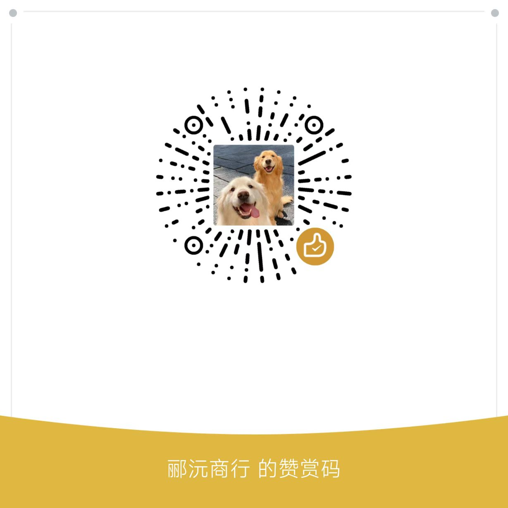

# LOOW · 安卓端编辑器

在手机上编辑动态壁纸：搭版面、连触发器、打关键帧、绑定系统数据，
点「保存」把预设发给壁纸 App，回到桌面就能看到。

## 这是什么

LOOW 壁纸引擎的配套编辑器，独立安装的 App（`com.loomwall.editor`）。

它本身不写渲染代码——是一层 WebView 壳，界面本体是 `tools/web-editor` 里那份手写的
HTML/CSS/JS（无框架、无构建），构建期同步进 assets。桌面浏览器打开同一个目录，
用的是同一套编辑逻辑，格式不会漂。

> **需要同时安装 LOOW 壁纸 App**（渲染端）：在 [KK-486/Loomwall](https://github.com/KK-486/Loomwall) 的 Releases 里下载。
> 编辑器只负责设计，保存的预设由它渲染上屏；两个 App 通过 `schema/` 里的 JSON 格式对接，代码不共享。

## 功能

- **图层**：矩形、文本、图片、容器；拖动排序、双击改名、嵌套进容器
- **属性**：位置 / 尺寸 / 圆角 / 旋转 / 缩放 / 透明度 / 颜色 / 渐变 / 羽化 / 视差
- **动画**：多组时间轴、六种缓动、关键帧拖动、中途可打断的补间
- **触发器**：节点式工作台，手势 / 命中图层 / 定时 / 出现时 / 变量变化，拖线即逻辑
- **数据绑定**：电量、温度、内存、存储、时间、通知、网络 → 直接驱动图层属性
- **本机项目库**：保存时自动留一份工程，随时重新打开接着改
- **撤销 / 重做**：顶栏常驻，误删不用重来

## 怎么用

1. 底部四个页签：**图层 / 属性 / 动画 / 逻辑**
2. 点图层选中元素，在「属性」里改参数；画布上直接拖动、四角缩放
3. 「动画」页打关键帧，「逻辑」页配交互
4. 顶部「🧩 触发器」进节点工作台；「⌗ 整理」按数据流自动排布
5. 点「保存」→ 预设发给壁纸 App，壁纸库里多一张卡片

竖屏是「画布 + 底部抽屉」，横屏自动切成「左画布 + 右抽屉」。

## 构建

不需要自己装 JDK / SDK / Gradle：仓库带一套便携工具链（JDK 17 + SDK 35 + Gradle 8.7），
第一次先跑（需要 Node.js，约 5 分钟）：

    tools\bootstrap.cmd

然后：

    build.cmd :editor:assembleDebug        :: debug 包
    build.cmd :editor:assembleRelease      :: 正式包

产物：**editor/build/outputs/apk/debug/editor-debug.apk**

发布签名用仓库外的 keystore：根目录放 **keystore.properties**（已在 .gitignore 里）就自动生效，
没有则退回 debug 签名，保证 clone 下来照样能构建。

## 目录结构

| 目录 | 内容 |
|---|---|
| `editor/` | 编辑器 App：WebView 壳、JS 桥、SAF 导出、分享 |
| `tools/web-editor/` | 编辑器界面本体（HTML/JS，无框架、无构建） |
| `tools/web-editor/mobile/` | 手机端布局层，只在 `html.loow-mobile` 下生效 |
| `schema/` | 预设格式的 JSON Schema（与壁纸引擎的契约） |
| `tools/` | 工具链引导、预设校验、图标生成 |

## 投喂

如果这个编辑器帮到了你，可以请我喝杯奶茶 ☕

完全自愿，不影响任何功能，也不换任何特权。

## 许可

Apache License 2.0，见 [LICENSE](LICENSE)。
